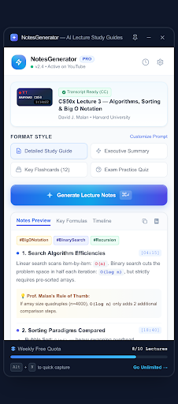

# NotesGenerator by Youssef — AI Lecture Study Guides

> **A client-only, serverless Chrome Extension (Manifest V3) that converts YouTube lectures into grounded revision notes, interactive Mermaid architecture diagrams, slide snapshots, and active-recall quizzes using Google Gemini & OpenRouter.**



---

## Key Highlights

- **$0 Server Cost & Full Privacy (BYOK)**: Connects directly from your browser to Google AI Studio or OpenRouter using your own API key. No intermediate backend, no tracking, and no servers.
- **Direct In-Browser Caption Extraction**: Extracts transcripts and captions straight from your active YouTube tab session, bypassing server IP rate limits and IP bans.
- **Strict Two-Stage Grounded Pipeline**:
  - **Stage 1 (Per-Window Grounding)**: 5-minute transcript windows strictly grounded in what the lecturer said, with exact clamped timestamps.
  - **Stage 2 (Whole-Lecture Synthesis)**: Synthesizes executive summary, system architecture diagram, core concepts, takeaways, and active-recall questions.
- **Visual Intelligence**:
  - **Interactive Mermaid.js Vector Diagrams**: System architectures, data flows, and state machines rendered cleanly with responsive vector graphics (with code/ASCII toggle).
  - **1-Click Slide Snapshots**: Captures high-resolution frames directly from the YouTube video player using HTML5 Canvas (`📸 Snap Slide`).
  - **AI Conceptual Illustrations (Imagen 3)**: Generates visual metaphors and analogies on demand via Google Imagen 3 (`🎨 Illustrate`).
- **Strict Grounded vs. Extension Badges**: Distinguishes what the lecturer explicitly taught (`From Lecture`) from AI-added prerequisites, worked examples, and next topics (`AI Extension`).
- **Interactive Player Seeking**: Click any timestamp badge (e.g., `[04:12]`) to seek the YouTube video directly to that second.
- **Publication-Grade Print to PDF & HTML**: Styled with `@media print` rules, embedded vector diagrams, captured slides, AI illustrations, and clean typography.
- **Instant Local Caching**: Notes are cached in `chrome.storage.local` by `video_id`, loading instantly upon revisiting without re-calling any API.

---

## Getting Started

### Prerequisites

- [Node.js](https://nodejs.org/) (v18 or higher recommended)
- `npm` or `pnpm`
- A Chromium-based browser (Google Chrome, Brave, Microsoft Edge, Arc, etc.)
- A Google Gemini API key ([Get a free key at Google AI Studio](https://aistudio.google.com/apikey)) or an [OpenRouter](https://openrouter.ai/keys) API key.

---

### Installation & Build

1. **Clone the repository:**
   ```bash
   git clone https://github.com/youssefkhabir/NotesGenerator-by-youssef-AI-Lecture-Study-Guides.git
   cd NotesGenerator-by-youssef-AI-Lecture-Study-Guides
   ```

2. **Install dependencies:**
   ```bash
   npm install
   ```

3. **Build the extension:**
   ```bash
   npm run build
   ```
   This compiles TypeScript, bundles React, and produces the production-ready extension in the `dist/` directory.

4. **Load the extension into your browser:**
   - Open your browser's extensions page:
     - **Chrome**: `chrome://extensions/`
     - **Brave**: `brave://extensions/`
     - **Edge**: `edge://extensions/`
   - Enable **Developer mode** (toggle in the top-right corner).
   - Click **Load unpacked**.
   - Select the `dist/` folder inside this project directory.
   - Pin **NotesGenerator** to your browser toolbar!

---

## How to Use

1. Navigate to any YouTube lecture (e.g., MIT OpenCourseWare, Stanford CS, 3Blue1Brown, Andrej Karpathy).
2. Click the **NotesGenerator** extension icon in your toolbar to open the **Side Panel**.
3. On first launch, click the **Settings ⚙️** icon in the header:
   - Paste your **Google Gemini API Key** (or OpenRouter key).
   - Select your preferred model (default: `Gemini 2.5 Flash`).
   - Save your settings.
4. Click **Generate Lecture Notes**.
5. Explore the generated notes:
   - Click timestamps to jump through the video.
   - Toggle between Mermaid diagram view and ASCII view.
   - Use **📸 Snap Slide** to capture presentation slides at key moments.
   - Test your understanding with the **Self-Test Quiz**.
   - Click **Print / Export** to save an HTML or PDF revision guide.

---

## Development

```bash
# Run Vite dev server for hot reload during component development
npm run dev

# Type-check and build production distribution into dist/
npm run build

# Preview build artifacts
npm run preview
```

### Project Structure

```
├── public/                 # Static extension assets and icons
│   ├── favicon.svg
│   ├── icons.svg
│   └── icons/              # Extension icons (16, 32, 48, 128px)
├── src/
│   ├── background/         # Background service worker (sidepanel behavior)
│   ├── content/            # Content script (YouTube DOM & caption scraper)
│   ├── components/         # Reusable React components (MermaidViewer, etc.)
│   ├── core/               # Business logic & LLM clients
│   │   ├── gemini.ts       # Google Gemini API client with budget escalation
│   │   ├── openrouter.ts   # OpenRouter client fallback
│   │   ├── imagen.ts       # Imagen 3 client for analogy illustrations
│   │   ├── pipeline.ts     # Two-stage extraction and synthesis pipeline
│   │   ├── schemas.ts      # Structured JSON schemas & prompts
│   │   ├── storage.ts      # chrome.storage.local wrapper & note caching
│   │   ├── tabTranscript.ts# In-tab transcript extractor
│   │   ├── transcript.ts   # Chunking, timestamps & text formatting
│   │   └── htmlExport.ts   # Standalone HTML/PDF export generator
│   └── sidepanel/          # Side Panel React App (UI, styling, controls)
│       ├── App.tsx         # Main application component
│       ├── index.css       # Tailwind & custom side panel styles
│       └── main.tsx        # React root entry
├── manifest.json           # Chrome Extension Manifest V3 configuration
├── vite.config.ts          # Vite configuration with standalone IIFE builder
└── package.json            # Project dependencies and build scripts
```

---

## Contributing & Forking

Contributions, bug reports, and feature requests are welcome!

1. **Fork the repository** on GitHub.
2. **Create your feature branch:**
   ```bash
   git checkout -b feature/amazing-feature
   ```
3. **Commit your changes:**
   ```bash
   git commit -m "Add amazing feature"
   ```
4. **Push to the branch:**
   ```bash
   git push origin feature/amazing-feature
   ```
5. **Open a Pull Request**.

---

## License

This project is licensed under the MIT License — see the repository files for details.
